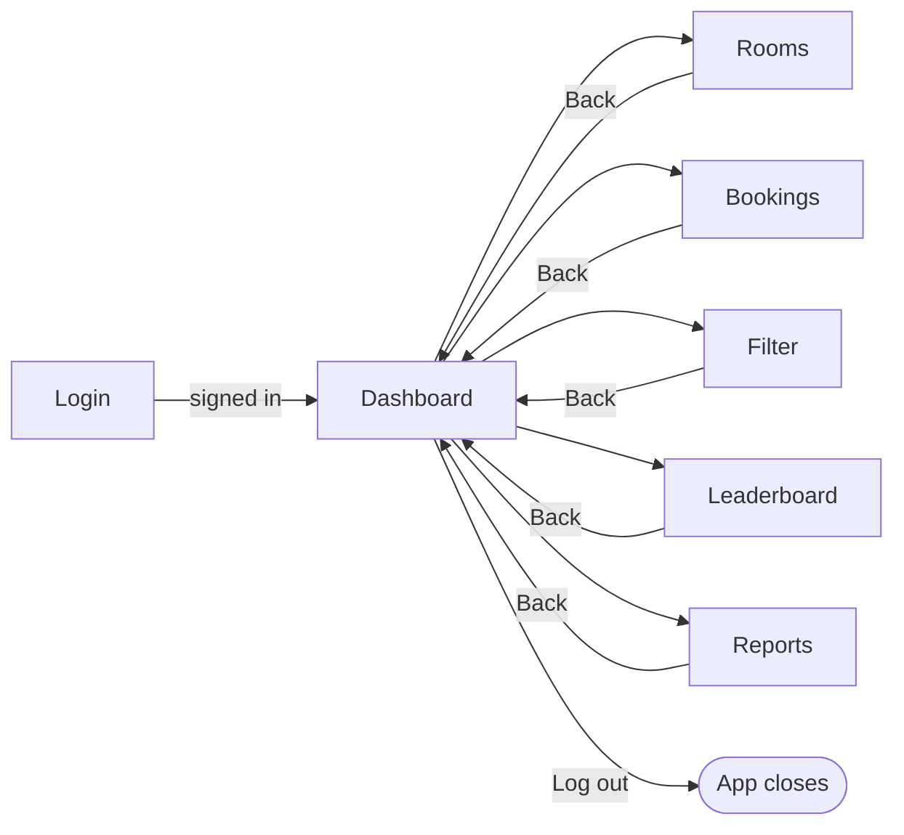
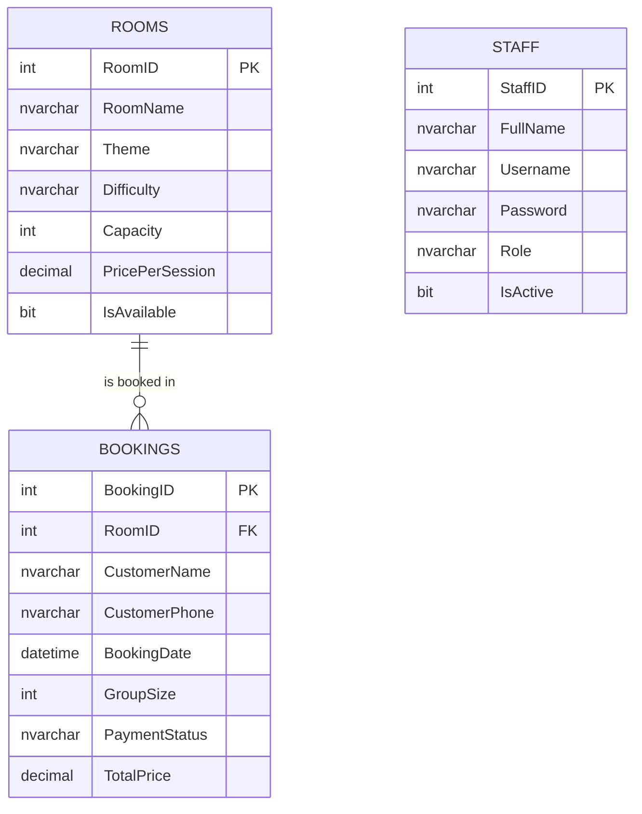

# Escape Room Management System

A Windows desktop app for the staff of an escape room business: manage the themed rooms, take bookings, filter them, and see revenue reports and a customer leaderboard. Built with C# Windows Forms and SQL Server by Hussein Hany, from the database design to the screens.

## Screens

| Screen | What staff can do |
| --- | --- |
| **Login** | Sign in with a staff account; the password can be shown or hidden |
| **Dashboard** | Today's bookings, today's revenue, available rooms, the most recent bookings, and a live clock; buttons to every other screen |
| **Rooms** | Add, edit and delete rooms (name, theme, difficulty, capacity, price per session, availability), with a live search by name |
| **Bookings** | Add, edit and delete bookings; the price is filled in from the room and the group size; live search by customer name |
| **Filter** | Find bookings by customer name, room, payment status and date range |
| **Leaderboard** | Customers ranked by how much they have spent on paid bookings, with search |
| **Reports** | Revenue and booking counts (paid, pending, cancelled) for a chosen date range, with a booking list |

`database-setup.sql` creates the database and the tables, and fills them with 20 sample rooms and 10 sample bookings.

## How the screens connect

## Database design

`STAFF` is used only for signing in. Each booking belongs to one room; a room can have many bookings.

## Run it

You need Windows, Visual Studio 2022 or later with the ".NET desktop development" workload, and SQL Server (Express or LocalDB is fine).

1. Open `database-setup.sql` in SQL Server Management Studio and run the whole script.
2. Open `EscapeRoomMS.slnx` in Visual Studio. NuGet restores the packages on the first build.
3. If your SQL Server is not the default instance, change `Data Source` in `Database/DatabaseHelper.cs` (for example `.\SQLEXPRESS` or `(localdb)\MSSQLLocalDB`).
4. Press F5 and sign in with the demo account **admin / admin123**.

## Built with

C# · .NET Framework 4.7.2 · Windows Forms · SQL Server · ADO.NET (`System.Data.SqlClient`)

## Project layout

| Path | What it holds |
| --- | --- |
| `Forms/` | One folder entry per screen: the logic (`*.cs`) and the generated layout (`*.Designer.cs`, `*.resx`) |
| `Database/DatabaseHelper.cs` | The connection and the query helpers every screen uses |
| `Theme.cs` | The shared look: colours, rounded bordered buttons with hover and press states, grid styling |
| `database-setup.sql` | Creates the database, the tables and the sample data |

## Notes

- **One theme for every screen.** `Theme.cs` gives all screens the same navy palette; buttons are rounded with a border that brightens on hover and darkens when pressed, colour-coded by role (green for main actions, amber for edits, red for delete and log out, grey for back and clear). Grids and panels are double-buffered, so they redraw without flicker.
- **Input checks.** A booking needs a group of at least one person and no larger than the room's capacity; a room needs a capacity of at least one and a price above zero.
- **Pricing.** Rooms are priced per session. The bookings screen shows the session price, which is the amount saved with the booking.
- **Safe queries.** Searches and filters use SQL parameters, so names with an apostrophe (such as "Pharaoh's Tomb") work.
- **Passwords** are stored as plain text, as in the original coursework; a real deployment would hash them. The extra staff accounts in the setup script use the placeholder password `ChangeMe1`.
- An earlier, partial version of this project is in this repository's history.
